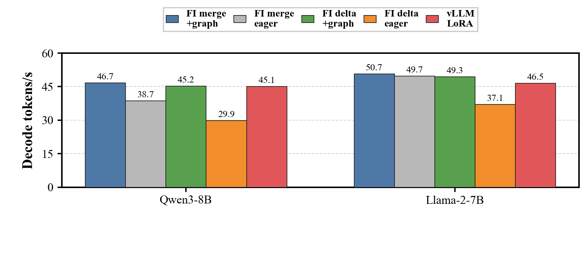
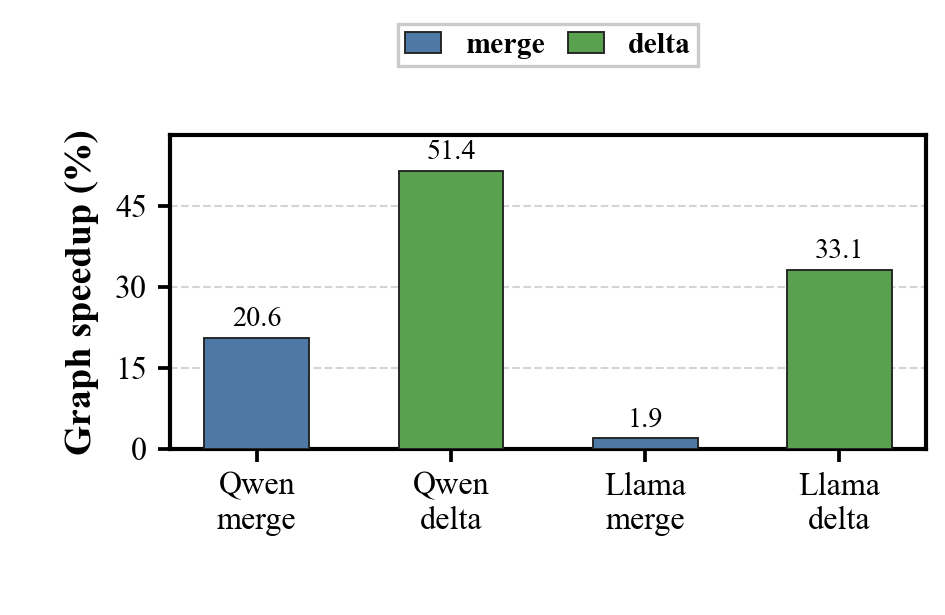
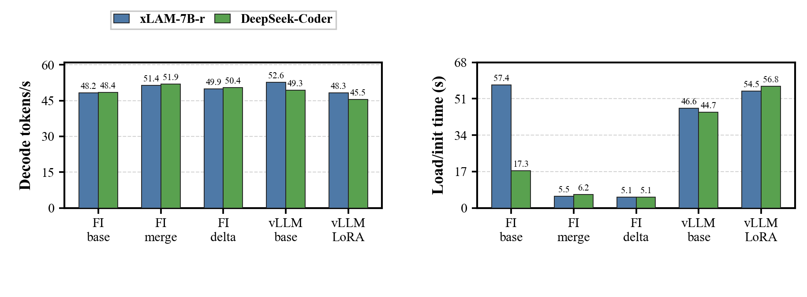
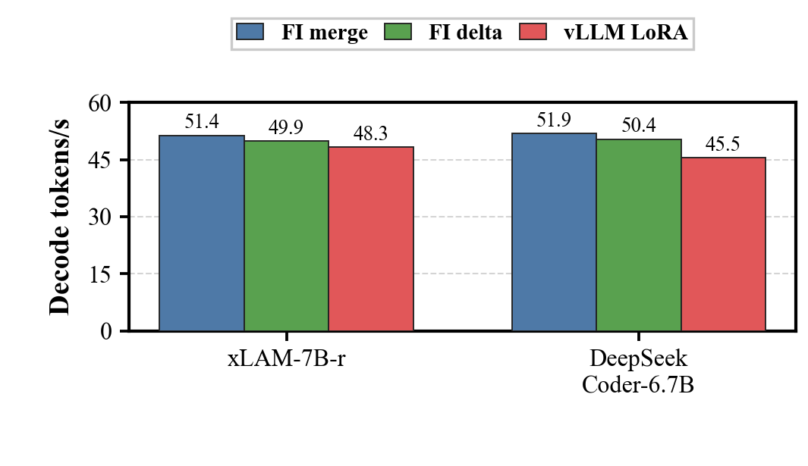
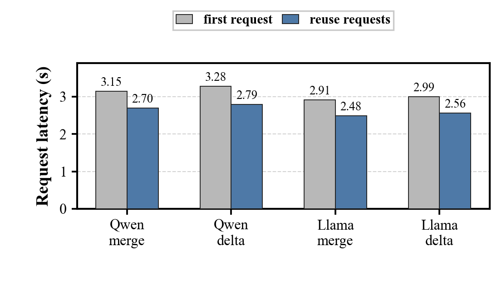
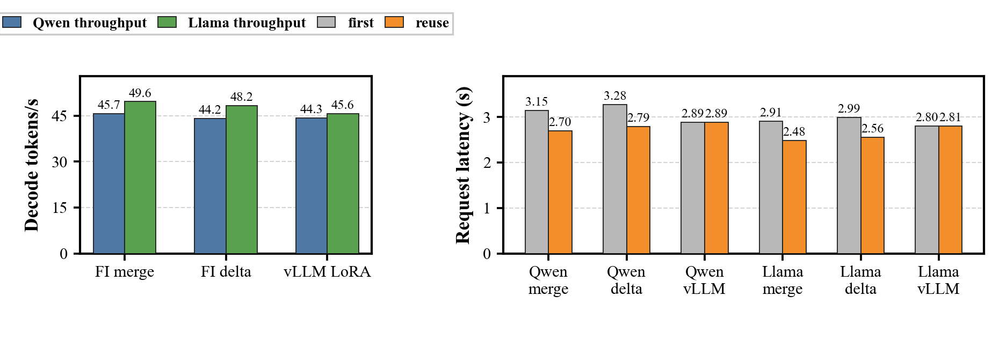
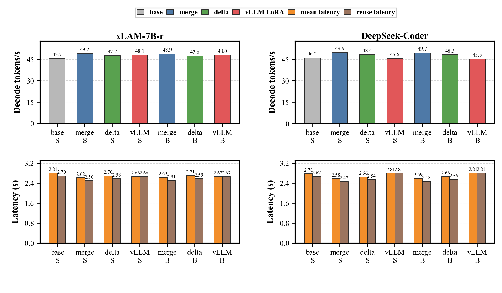
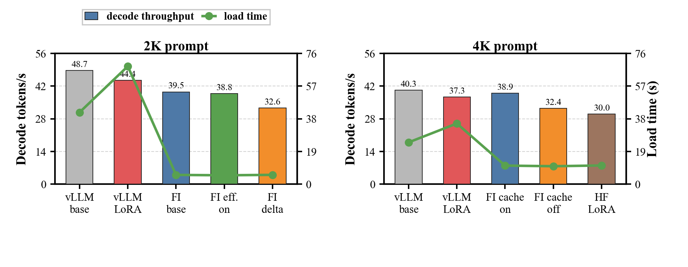
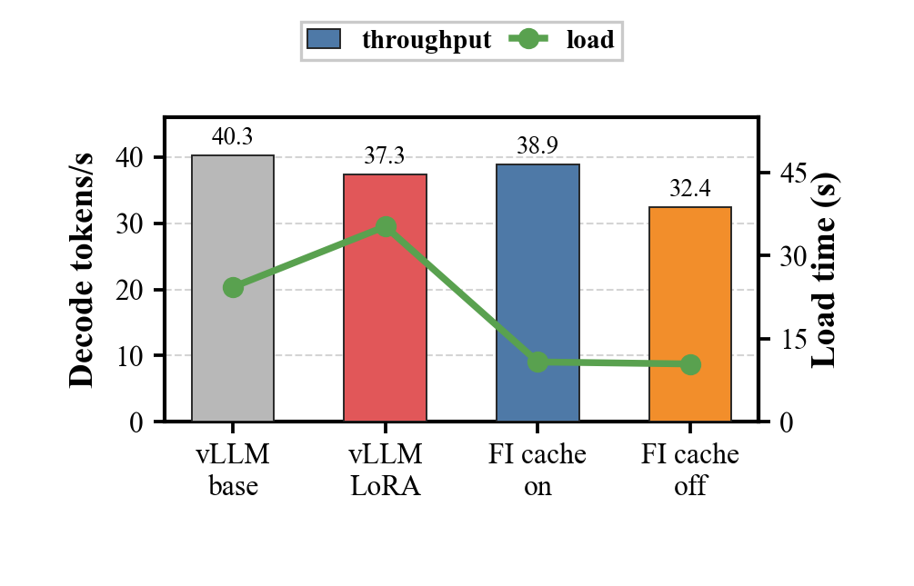
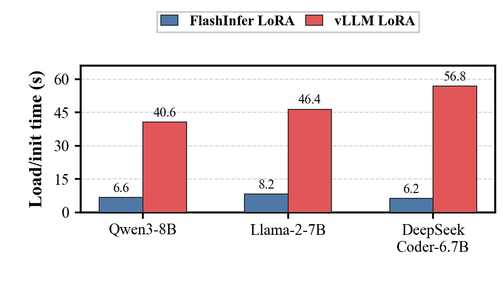

# PageLoRA

PageLoRA is a FlashInfer-based inference engine for low-latency LoRA serving on a single GPU. It focuses on the decode path of transformer inference, combining paged KV cache management, prefix reuse, CUDA graph replay, FlashInfer kernels, and lightweight LoRA weight handling.

The implementation targets practical edge-side and workstation-class deployments where startup time, memory pressure, and repeated short interactions matter as much as peak throughput.

## Highlights

- FlashInfer paged-KV attention with reusable page-table buffers.
- Prefix-aware KV cache manager with radix lookup and page admission.
- CUDA graph decode replay with graph buckets keyed by cache, page table, adapter, role, and runtime version.
- Fast LoRA serving through merged/effective weights and true A/B delta execution.
- Memory-aware coordination between adapter residency and KV cache residency.
- Benchmark entry points for FlashInfer, vLLM, Hugging Face, LoRA serving, and prefix reuse.

## Results

Experiments were run mainly on an NVIDIA RTX 3090 24GB with 5B-8B models. Detailed raw tables are in [docs/experiment_results_infer_engine.md](docs/experiment_results_infer_engine.md).

| Setting                                                     |      Result |
| ----------------------------------------------------------- | ----------: |
| Qwen3-8B FlashInfer LoRA merge with CUDA graph              | 46.68 tok/s |
| Qwen3-8B FlashInfer LoRA no-merge with CUDA graph           | 45.23 tok/s |
| Llama-2-7B FlashInfer LoRA merge with CUDA graph            | 50.71 tok/s |
| Llama-2-7B FlashInfer LoRA no-merge with CUDA graph         | 49.34 tok/s |
| xLAM-7B FlashInfer LoRA merge, 512-token decode             | 51.36 tok/s |
| DeepSeek-Coder-6.7B FlashInfer LoRA merge, 512-token decode | 51.88 tok/s |

### Experiment Figures









#### Prefix Reuse







#### Long Context





#### Load Time



## Project Layout

```text
core/                 shared constants and runtime utilities
data/                 prompt and tokenizer helpers
model/flashinfer/     FlashInfer decode, CUDA graph, packing, sampling, and profiling code
model/kvcache/        paged KV cache, radix prefix cache, page admission, and page tables
multilora/            LoRA runtime, adapter switching, merged weights, and offload support
test/inference/       benchmark launchers and shared benchmark harness
test/                 unit tests for cache, graph, backend, and benchmark entry points
docs/                 experiment records
assets/figures/       experiment figures
```

## Installation

Use Python 3.10 or newer and a CUDA-capable PyTorch environment.

```powershell
pip install -r requirements.txt
```

FlashInfer paged-KV execution requires CUDA. Some JIT paths also require a system CUDA Toolkit with `nvcc`, not only the CUDA runtime bundled with PyTorch.

## Benchmark Examples

FlashInfer generation benchmark:

```powershell
python -m test.inference.bench_flashinfer_generate `
  --model-path D:\models\Qwen3-8B `
  --target-prompt-tokens 2048 `
  --max-new-tokens 128 `
  --warmup-runs 1 `
  --measure-runs 3 `
  --flashinfer-cuda-graph-decode
```

Prefix reuse benchmark:

```powershell
python -m test.inference.bench_prefix_caching `
  --model-path D:\models\Qwen3-8B `
  --engine flashinfer `
  --prefix-bench-mode branch `
  --shared-prefix-tokens 2048 `
  --branch-suffix-tokens 64 `
  --prefix-requests 4 `
  --max-new-tokens 128 `
  --flashinfer-cuda-graph-decode
```
