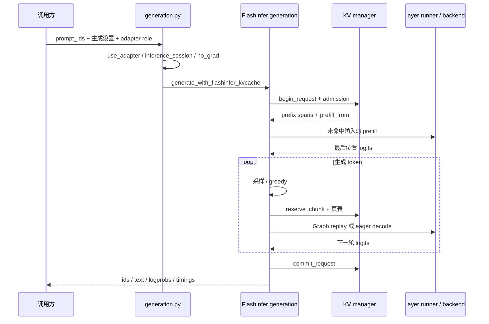

# PageLoRA 技术详解与代码导读

补充：跨后端真实模型检查与自动报告已新增独立工具，见 [对照验证与自动报告](对照验证与自动报告.md)。本文后续关于“启动器不负责正确性”的边界仍成立：正确性由单独的 `scripts.check_inference_correctness` 执行；性能启动器现会采样整张 GPU 显存，但不是精确进程峰值。

本文面向重新接手项目的开发者，重点解释“代码为什么这样组织、一次请求实际怎样运行、修改哪里会影响什么”。依据当前仓库静态阅读编写，更新于 2026-11-10。代码行为与设计意图分别说明；不把现有测试文件或历史记录等同于当前服务器已验证通过。

## 阅读导航

- 想先恢复整体记忆：读第 1–3 节。
- 想弄清一次请求：读第 4–6 节。
- 想理解 CUDA Graph、LoRA 与优化代价：读第 7–10 节。
- 想接着开发、排查问题：读第 11–15 节。

相关文档：[项目说明](项目说明与课程适配.md)、[服务器实验指南](服务器实验指南.md)、[历史结果台账](experiment_results_infer_engine.md)。

## 1. 工程的核心边界

PageLoRA 复用 Hugging Face 加载的模型参数和 tokenizer，但在 FlashInfer 模式下自行执行 Transformer 层、维护 KV 缓存和生成循环。它并非给 `model.generate()` 加一个开关，也不是完整替代 vLLM 的在线服务系统。

项目核心包括三层：

1. **执行层**：手动组织 RMSNorm、QKV 投影、RoPE、注意力、输出投影和 MLP；部分操作交给 FlashInfer。
2. **状态层**：分页存储每层 KV，用 Radix 树记录 token 前缀与 KV 页片段的关系，用请求对象管理本次增量。
3. **运行时层**：选择 base/serve/train 角色，管理 LoRA 参数、有效权重、图捕获缓存和可选显存协调。

FlashInfer 是内核与 attention wrapper 的提供者；分页、前缀索引、请求生命周期以及 LoRA 的协调主要是本项目代码负责。

### 1.1 不要混淆的几个概念

| 名称 | 在本项目中的含义 | 不等同于 |
|---|---|---|
| KV cache | Transformer 各层历史 K、V 张量 | 模型权重缓存 |
| Radix cache | token 前缀索引及对应 KV 片段元数据 | 直接把全部 KV 放进树节点 |
| paged KV | 逻辑序列由多个物理页表示 | 必然使用稀疏 GPU 内存分配 |
| full KV | 存储计算完成后的完整 K/V | 当前仓库可用的 `full` 后端 |
| adapter role | base、serve、train 的计算角色 | attention 后端选择 |
| CUDA Graph | 捕获 GPU 工作并重放 | 自动消除整个 Python 生成循环 |
| packed weights | 拼接多个线性层权重，减少投影调用 | 量化权重 |
| effective weights | 额外缓存已折叠 LoRA 的权重 | 一定原地修改基础权重 |

### 1.2 现有与遗留路径

`ModelConfig` 和生成分发仍保留 `hf/br/full/flashinfer` 名称。当前仓库存在 HF 与 FlashInfer 主路径，但 `model/brcache/`、`model/fullcache/` 不在当前文件树中。选择 `br/full` 会触发这些缺失模块的导入，不能因为配置枚举存在，就认为实现完整。

类型中保留 `BR_BASE_KEY`、`BR_RESIDUAL_KEY`，`LoRALinear` 也保留返回低秩中间激活的接口；它们说明曾为分解缓存预留结构，不构成当前跨 LoRA 共享 KV 的完整证明。当前 FlashInfer manager 使用的是 `FULL_KEY(adapter)` 命名空间。

## 2. 代码地图与建议阅读顺序

| 层次 | 文件 | 先看什么 |
|---|---|---|
| 模型入口 | `model/model_manager.py` | `ModelConfig`、构造函数、`use_adapter`、`inference_session` |
| 生成分发 | `model/generation.py` | `GenerationOutput`、`generate_with_logprobs`、`generate_batch` |
| 单次执行 | `model/flashinfer/generation.py` | `generate_with_flashinfer_kvcache`、prefill/plan helper |
| 单层执行 | `model/flashinfer/layer_runner.py` | `_run_flashinfer_attention`、static append 路径 |
| 内核封装 | `model/flashinfer/attention_backend.py` | `plan_decode/prefill` 与 `run_decode/prefill` |
| 缓存调度 | `model/kvcache/paged_kvcache_manager.py` | `begin_request`、`reserve_chunk`、`commit_request`、`abort_request` |
| 物理存储 | `model/kvcache/paged_kv_store.py` | 页预留、写入、dense tensor 扩容与释放 |
| 前缀索引 | `model/kvcache/radix_cache.py` | `lookup`、`insert_coverage` |
| 图重放 | `model/flashinfer/cuda_graph.py` | `DecodeGraphKey`、runner 的 `run/_capture/_decode_static` |
| 适配器 | `multilora/runtime.py`、`linear.py` | `set_active`、状态加载/发布、线性层 forward |
| 权重优化 | `effective_weights.py`、`packed_ops.py` | 有效权重缓存与投影选择 |
| 实验入口 | `test/inference/common.py` | manager 构造、各引擎计时方式 |

路径均相对于仓库根目录。

## 3. 初始化：ModelManager 到底做了什么

### 3.1 ModelConfig 的关键项

| 参数 | 默认值/行为 | 影响 |
|---|---|---|
| `model_name` | 必填 | HF 模型 ID 或模型目录 |
| `kvcache_mode` | `hf` | 选择主执行路径，构造函数还可能根据其它项归一化 |
| `enable_multilora` | false | 不代表完全不安装 LoRA；构造函数仍初始化手动 LoRA runtime |
| `lora_r/alpha/dropout` | 16 / 32 / 0.05 | 低秩参数大小、缩放与 dropout |
| `target_modules` | q/k/v/o 投影 | 手动包装哪些线性层 |
| `logical_adapters` | `('general',)` | 逻辑适配器名称集合 |
| `flashinfer_page_size` | 32 | 每物理页容纳的 token 数 |
| `flashinfer_max_pages` | 0 | 0 为无显式页数上限，非无限显存 |
| `flashinfer_workspace_mb` | 128 | attention workspace 大小 |
| `flashinfer_kv_append_mode` | manual | 选择 KV 写入实现 |
| `flashinfer_cuda_graph_decode` | false | 请求启用图重放；仍需满足执行条件 |
| `adapter_offload` | false | 开启适配器/缓存显存协调 |
| `cpu_offload` | false | 实验性 CPU 模型路径，不建议作为主实验默认项 |

几个布尔值可能互相影响。最稳妥的 FlashInfer 配置是明确设置 `kvcache_mode='flashinfer'`，不要只设置某个 legacy 标志并猜测最终路径。最终以初始化日志中的归一化配置为准。

### 3.2 初始化顺序

1. 根据配置归一化缓存模式，选择 device 和 dtype。
2. 加载 tokenizer；缺少 pad token 时尝试用 EOS 补齐。
3. 通过 `AutoModelForCausalLM.from_pretrained()` 加载基础模型；默认将其放到 GPU。
4. 设置初始 `use_cache=False` 并启用 gradient checkpointing。此处保留训练友好默认值，不能据此判断推理时也处于训练模式。
5. 创建 `LoRARuntime`，发现 decoder 层、安装手动 `LoRALinear` 包装、注册逻辑适配器、绑定 serve 参数。
6. 将 LoRA 张量移动到目标设备；按配置注册显存协调器。
7. FlashInfer 模式创建 `FlashInferPagedKVCacheManager` 并交给 runtime；其它后端按各自分支处理。
8. 若启用共享 packed storage，提前准备 QKV/gate-up 权重存储。

`core/utils.py:get_torch_dtype()` 在 CUDA 上优先 BF16，不支持时 FP16，CPU 为 FP32。当前实验启动器另有 BF16 预检，以保持与 vLLM 显式 dtype 一致。

### 3.3 两个上下文管理器

`use_adapter()` 记录原角色和适配器，临时切换，在 finally 中恢复。`inference_session()` 临时 `eval()`、关闭 checkpointing、设置 HF `use_cache`，完成后恢复原状态。

FlashInfer 传 `enable_cache=False`，因为 KV 由项目外部缓存管理，不是因为“不缓存历史”。HF 路径则开启 HF 自带缓存。

## 4. 一次单请求的完整调用链



### 4.1 API 输入输出

`generate_with_logprobs()` 接收已分词的 `prompt_ids`，不负责从原始字符串构造聊天模板。聊天编码入口在 `data/tokenizer_utils.py` 与 `data/chat_template.py`。

主要输出 `GenerationOutput` 包含文本、生成 token IDs、可选 logprobs 与 timings。性能测试使用实际 `response_ids` 长度，不能假设总是等于请求的 `max_new_tokens`。

### 4.2 prefill 前的准备

`generate_with_flashinfer_kvcache()` 先检查输入非空，取得/复用 backend，调用 `begin_request()`，再调用 page admission。admission 可能回收缓存、重新打开请求，甚至缩减允许生成的 token 数，因此后续必须使用返回的新 request、新 `new_ids` 和新预算，不能继续使用 admission 之前的本地变量。

### 4.3 prefill

只对 `prompt_ids[prefill_from:]` 计算。position 从 `prefill_from` 起，不应从零重新编号。每层将新 K/V 写入预留页，同时读取前缀页与本次新页执行注意力。末层 hidden 经最终 norm 和 lm_head 生成下一 token 的 logits。

### 4.4 decode 与 token/KV 的对应关系

关键顺序是：**已有 logits → 选出 token → 检查停止条件 → 将该 token 输入模型并写 KV → 得到下一轮 logits**。

因此“返回了某 token”不自动代表“该 token 已写进 KV”。例如遇到 EOS 时，可以在 forward 前退出。代码分别维护 generated 与 cached-generated 列表，提交时使用 `prompt_ids + cached_generated_ids`，避免给尚未写入 KV 的 token 建立虚假覆盖。

FlashInfer 单请求和批请求在采样达到输出预算后直接退出，不再计算下一轮 logits 或分配 KV。缓存仍只提交实际完成 forward 的 token，不能把全部输出视为已缓存。此停止边界与 HF benchmark 的手工循环一致。

### 4.5 成功与失败

正常结束通过 `commit_request()` 将请求增量接入前缀索引；`committed` 标志用于在 finally 中决定是否执行 `abort_request()`。新增错误路径时要核对异常发生在 admission、执行 try/finally 的哪一侧，不能只看到函数末尾有 abort 就假定所有错误都已覆盖。

## 5. 分页 KV：数据结构、布局与生命周期

### 5.1 四个关键对象

| 对象 | 保存内容 | 生命周期 |
|---|---|---|
| `PagedKVAllocator` | 页 ID、allocated set、free list | manager/store 级 |
| `PagedKVBlockStore` | 页归属与实际 dense KV tensor | 跨请求 |
| `RadixPrefixCache` | token 路径和各 key 的 KVBlockSpan | 跨请求 |
| `FlashInferPagedKVRequest` | 本次命中前缀、新增页片段、写入进度 | 单次请求 |

`KVBlockSpan(block_id, start, length)` 表示物理页中的一段；`TokenSpan` 表示 token arena 中的一段。名字中的 block 在 FlashInfer 存储路径里实际对应物理页。

### 5.2 KV 的实际 tensor 布局

全层 dense cache 的形状为：

```text
[num_layers, capacity_pages, 2, page_size, num_kv_heads, head_dim]
                            ↑ K/V
```

单层 cache 去掉最外层 layer 维。NHD 写入 API 的 K/V 为 `[tokens, kv_heads, head_dim]`。物理页 ID 是 dense cache 的页维下标，不是虚拟地址。

每页理论字节数为：

```text
layers × 2 × page_size × kv_heads × head_dim × dtype_bytes
```

示例：32 层、8 KV heads、head_dim=128、BF16，每 token 的全层 KV 约 128 KiB；4096 tokens 约 512 MiB，不含 workspace、权重、临时激活、图池及空闲容量。这个示例不是所有 7B 模型的固定值，应读取具体 config。

### 5.3 “分页”与 dense capacity 并不矛盾

逻辑管理使用页，但底层仍是一块可容纳多页的 dense tensor。`max_pages=0` 时，首次容量至少 16 页，后续按 `max(16, old_capacity*2, required)` 扩容；设置上限时，dense 分配可直接按该页上限进行。

扩容需要新 tensor 并复制旧缓存，峰值阶段可能同时持有新旧存储。于是：

- `allocated_pages` 是逻辑正在使用的页数。
- `dense_capacity_pages` 是底层已分配容量。
- free list 回收页 ID，不等于相应 GPU tensor 立即缩小。
- 页数上限不等于全进程显存上限；不设置页上限也不会阻止真实 CUDA OOM。

### 5.4 Request 字段速查

| 字段 | 语义 |
|---|---|
| `match_len` | Radix 对该 key 报告的 KV 命中长度 |
| `prefill_from` | 后端实际从哪个 token 重新计算 |
| `materialized_from/to` | 本次物化的逻辑范围信息 |
| `prefix_spans` | 可直接读的已有前缀片段 |
| `new_spans` | 本次新分配/扩展的后缀页片段 |
| `current_kv_len` | 当前请求可见的 KV 长度 |
| `page_span_chunks` | 按执行 chunk 组织的新增 span |
| `layer_chunk_counts` | 各层对 chunk 的写入进度 |

### 5.5 生命周期与并发限制

`begin_request()` 在 manager 内检查 active guard。同一 manager 不允许任意两个生成调用同时进入；已有单请求或 batch 时再 begin 会报 `KV cache request already active`。批处理有 `begin_batch_requests()`，但不是通用线程安全调度器。

`reserve_chunk()` 预留本次 chunk 的页位置。各层向同一 token chunk 对应的不同 layer 维写入，不能每层都重新申请一份逻辑 token 页。图路径直接写入，需要 `mark_graph_decode_chunk_written()` 补齐 manager 的进度记录。

`commit_request()` 的重点不是把完整 KV 再复制一遍：大张量已在执行期间写入，提交主要更新 Radix coverage、清理未提交页并同步元数据。若为了页对齐而重算了一部分前缀，提交可能替换该适配器的 coverage，避免以后持续返回后端无法消费的片段。

`abort_request()` 释放 request-local 新页并清除 active 状态，不能把可复用前缀页当成本次新增页一起删掉。

## 6. Radix 前缀缓存与页对齐

### 6.1 为什么采用压缩前缀树

相同 token 前缀共享树路径，不同后缀在分叉处分裂。节点边不是单个 token，而是 token arena 中的一段 `TokenSpan`；KV coverage 也只对应该入边区间。通过 span 切片和拆分维护关系，而不是为每个节点复制整段 KV。

`lookup()` 同时处理“token 路径匹配”与“某缓存 key 有连续 KV 覆盖”。树里存在 token 路径，不代表每个 adapter 都有该路径的可用 KV；查看 `key_match_len` 和 `key_spans`，不能只用 token-level `matched_len`。

### 6.2 为什么 match_len 不等于实际复用长度

FlashInfer 页表要求从页起点开始，中间页完整，尾页可以部分有效。manager 对可复用前缀进一步采用完整页边界约束，`_flashinfer_usable_prefix_len()` 遇到非零 start 或不足一页的片段就停止。

如果 prompt 全命中，代码先将候选 `prefill_from` 调到 `prompt_len-1`，因为需要至少重新处理最后一个 prompt token 来取得 logits；之后还要执行页对齐，实际回退可能超过 1 token。

**示例：page_size=32，输入 100 tokens 全命中。** Radix `match_len=100`；候选重算起点为 99；可用整页前缀通常为 96；实际重算 token 96–99，即 4 tokens。不能看到 `match=100` 就写“本次 prefill 完全为零”。

### 6.3 页表是什么

`FlashInferPageTable` 包含三个 int32 GPU tensor：

```text
paged_kv_indptr         每请求在 indices 中的范围
paged_kv_indices        按逻辑顺序排列的物理页 ID
paged_kv_last_page_len  每请求尾页有效 token 数
```

例如单请求物理页为 `[7,2,9]`、page_size=32、长度70：`indptr=[0,3]`、`indices=[7,2,9]`、`last_page_len=[6]`。物理页无需相邻，但逻辑顺序必须正确。

可复用 buffer 减少反复分配，但不消除构造过程：当前 update 仍可能创建临时 tensor 并复制 indices。页表容量增长会改变底层地址，Graph 需要据此重新匹配/捕获。

### 6.4 请求准入：空间不足时怎么办

`admit_paged_kv_request()` 按以下顺序尝试：

1. 检查未命中 prefill + 请求 decode 预算 + 默认 4 个预留页是否容纳得下。
2. 尝试释放非当前 KV 缓存，保护活动请求需要的前缀，再检查。
3. abort 本次请求，释放当前适配器缓存，重新 begin。
4. 估计最大能容纳的 decode 数；必要时缩减输出预算。
5. 连至少可接受的 decode 都放不下时拒绝并抛错。

这是页预算准入，不是完整的 CUDA 内存预测；临时权重、attention workspace、图池仍可能引发真实 OOM。性能测试必须检查实际输出 token 数和 `decode budget reduced` 日志。

## 7. Transformer 单层执行细节

主要入口是 `layer_runner.py:_run_flashinfer_attention()`：

```text
hidden
  → input RMSNorm
  → Q/K/V 投影（可打包，可包含 LoRA）
  → 可选 Q/K head norm
  → 根据绝对 position 对 Q、K 做 RoPE
  → 写入旋转后的 K 和 V
  → backend.run_prefill 或 run_decode
  → o_proj + residual
  → post-attention RMSNorm
  → gate/up 激活与乘法 → down_proj
  → residual
```

attention backend 的 plan 使用 `pos_encoding_mode='NONE'`，因为 Q/K 已在外部做 RoPE。若再开启 wrapper 内部 RoPE，会重复旋转，属于正确性错误。

`plan` 与 `run` 是两件事：plan 准备页表、形状和内核执行信息；run 才执行注意力。计划通常按请求/step 准备，然后被多层复用。不能为了省时间跳过页长度变化后的必要 plan，也不能在每层无条件重复 plan。

自定义执行直接依赖典型 decoder 结构，如 `model.model.norm`、`layer.self_attn`、`q_proj`、`gate_proj/up_proj/down_proj` 等。HF 能加载一个模型，只说明参数加载成功，不代表这个手写执行器支持它。MoE、视觉模型、混合注意力、特殊 RoPE 等需要逐项适配。

## 8. CUDA Graph：捕获什么，怎么判定可复用

### 8.1 单请求启用条件

除了开关为 true，还要求 CUDA 可用、输出预算大于零，并命中 GPU greedy 快路径：

```python
sampling_mode == 'greedy_fast'
and not compute_logprobs
and repetition_penalty == 1.0
```

因此只加 `--flashinfer-cuda-graph-decode` 不保证真正执行 replay。查看 capture/replay/fallback 日志；不要只根据参数报告已启用。

### 8.2 静态输入与图主体

runner 维护固定地址的 token、position、page ID、page offset buffer。每轮先把动态值写进这些 buffer，再重放图。

`_decode_static()` 内包含 embedding、逐层 static-append decode、最终 norm 和 lm_head。采样、Python 循环、页预留、页表更新及 plan 等仍有图外工作。Graph 返回的 logits 是图拥有的可重用 buffer；下一次 replay 可能覆盖，若需长期保存必须明确复制。

### 8.3 DecodeGraphKey

图键包含 model/backend 身份、KV tensor 的地址/shape/dtype、三个页表 buffer 地址、输入 shape、页表页数、active adapter/role、runtime version。

这是必要的防错：图捕获的指针必须继续有效。KV 扩容、页表扩容、适配器变化可能要求新图。即使 shape 一样，地址变了也不能直接复用旧图。

图条目默认最多 32 个，容量由环境变量控制；当前字典淘汰从最早插入项开始，不是命中后自动更新的严格 LRU。跨页增长和频繁角色切换可能导致多次捕获，应查看捕获数量与缓存数量。

### 8.4 fallback

单 token chunk 不满足单页条件，或 capture 异常时 runner 可返回 None；生成循环转 eager。capture 失败会记录 disabled reason 并清空相关图缓存，后续不应仍假设它在重放。

修改 static path 时避免引入 `.item()`、动态分配、CPU 同步或依赖 Python 值分支的 GPU 工作；先验证 eager，再验证 graph。

## 9. LoRA：参数、角色与三种计算方式

### 9.1 数学与 tensor 方向

对输入 `x[..., in]`，`W[out,in]`、`A[r,in]`、`B[out,r]`：

```text
y = linear(x, W) + linear(linear(dropout(x), A), B) × alpha/r
```

训练时保留 A/B 的梯度；推理 merge 仅在 dropout 可视为 identity 等条件满足时有意义。

### 9.2 base / serve / train

- `base`：只走基础线性层，切入前需撤销已原地合并的适配器。
- `serve`：绑定当前逻辑适配器的冻结服务参数。
- `train`：使用单独物化的 train workspace，不直接覆盖前台 serve 参数。

`LoRARuntime` 的 registry 管理多个逻辑 adapter 的 A/B，但当前 active 角色和绑定是共享可变状态。不能把一个 manager 的临时 `use_adapter()` 当作多线程请求隔离。

`prepare_train_workspace`、shadow staging、publish 等为训练/发布保留接口。当前仓库有运行时能力不代表已经有完整的训练任务编排或强化学习流水线。

### 9.3 不要把所有 merge 混为一谈

| 路径 | 实现 | 主要收益 | 主要代价 |
|---|---|---|---|
| A/B delta | 每次 forward 计算低秩增量 | 保留基础权重、便于切换 | 更多小 GEMM 与中间张量 |
| 原地 single LoRA merge | 将 `B@A*scale` 加到原 W；退出时减回 | 减少重复增量计算，避免额外完整有效权重 | 切换/合并耗时、低精度加减误差风险 |
| effective weights | 缓存新的 `W_eff=W+delta`，可进一步打包 | 服务 forward 更直接 | 额外权重显存和失效维护 |

原地 merge 由 `MINI_OPENCLAW_FLASHINFER_SINGLE_LORA_MERGE=1` 控制。effective 默认会随 memory mode、packed storage、single merge 设置变化；不能只关闭 single merge 就声称测到了真正 A/B 路径。严格 A/B 对照应同时关闭 effective weights，并记录其它 packed 相关项。

原地 unmerge 会按绑定 A/B 重新计算 delta，因此不要绕过 runtime 在合并状态直接修改 A/B；否则减掉的不再是原来加上的值。反复 BF16 加减也值得做数值回归。

### 9.4 权重变化与缓存失效

这里至少有三类缓存：KV、有效/打包权重、CUDA Graph，不能只清其中一种。

`ModelManager.load_serve_state()` 调 runtime 加载并清权重缓存/更新版本，随后 invalidate adapter KV；`commit_train_to_serve()` 也处理 KV 失效。shadow publish 则可将已为新权重构建的 shadow KV 转给正式 adapter。

**建议通过 manager 的高层方法更新参数。** 只调用底层 runtime 的加载方法，或直接写 tensor，可能绕过 manager 的 KV 失效协议。

FlashInfer KV key 当前按 `full:adapter_name` 组织，本身不显式编码 role 与权重版本。生成调用却支持同一 logical adapter 下切换 base/serve/train。跨角色复用同一 manager 的 KV 是否被完整隔离，应专门测试；在验证前，实验使用独立进程/manager 或显式清缓存。图键包含 role 并不能替代 KV 的角色隔离。

## 10. Packed、compile 与显存协调

### 10.1 Packed QKV / MLP / LoRA

QKV 权重沿输出维拼接，一次投影后切分 Q/K/V；gate/up 类似，后接 SiLU(gate) × up。低秩 delta 也可打包，减少小算子调用。数学上能拼接不代表所有模块组合都兼容，代码有 shape、激活和 LoRA 状态条件检查。

throughput 模式可能保留额外 packed/effective 存储。balanced/low_vram 可采用共享 packed base storage，用视图或共享存储减少副本。这里会影响权重地址、缓存键、merge 与图捕获，修改后需同时回归。

### 10.2 torch.compile

`compile_config.py` 默认关闭，可分别编译 MLP 和 attention 后处理。无 compile cudagraphs 时显式关闭 Triton cudagraphs；启用时涉及 step 标记和输出生命周期。它与手动 `torch.cuda.CUDAGraph` 不是同一个开关。做 Graph 消融时先固定 compile 关闭，避免无法分辨收益来源。

### 10.3 MemoryAwareCoordinator

协调器跟踪适配器和 KV 的访问、字节数与优先级，面临压力时选择 offload 候选，并保护当前 adapter。默认未开启；不能因为文件存在就把一次实验描述为启用了自动显存协调。

它不是统一 CUDA allocator，也不精确追踪所有 workspace/graph pool。其它训练内存估计接口属于预估，不是保证不会 OOM 的上界。

## 11. 批处理能力的边界

仓库有 `generate_batch()`、FlashInfer batch prefill/decode、batch 页表和 batch Graph runner。batch prefill 采用 packed token 布局 `[1,total_tokens,hidden]` 配合每请求长度；decode 使用 `[batch,1,hidden]`。

这说明有静态批次执行能力，不说明已经实现连续批处理服务。请求到达、动态加入/移出、队列、公平调度、多适配器并发与异步取消都需要额外系统设计。当前 course launcher 是多个独立进程串行执行，适合单卡基准，不是压测服务端。

## 12. Benchmark 的真实计时口径

### 12.1 三条路径并不完全一样

- 项目公开 HF API 使用 `model.generate()`；`test/inference/common.py` 的 HF benchmark 为方便阶段计时，手工调用 forward/past_key_values。
- FlashInfer benchmark 调项目生成函数，结合外部同步总时间和内部 trace。
- vLLM benchmark 直接创建独立 `LLM`，不经过本项目 ModelManager、LoRALinear 或分页 manager。

所以“同一个 benchmark 工具”不代表“同一个执行循环”。HF 基线也并非未经任何工程开销的理论最低延迟。

### 12.2 指标

主实验使用总请求耗时和 `actual_generated_tokens/total_s`。旧 `decode_tokens_per_s` 使用输出 token 数除 decode 时间，但各引擎首 token、末步 forward、TTFT 和总时间边界存在差异。

FlashInfer `FlashInferPerfTrace` 默认启用，`PERF_SYNC=0` 时低层计时多为 CPU 提交时间，不能称 kernel GPU 耗时；`PERF_SYNC=1` 逐段同步又会显著改变性能。关闭 trace 后部分 timings 会缺省为零，不能把缺省值当真实测量。

### 12.3 前缀 benchmark 修正

原 vLLM decode helper 先做 max_tokens=1 探测，再做正式请求；启用前缀缓存时探测会改变缓存状态。当前前缀 runner 复制 args 并强制 `throughput_timing='total'`，只做单次正式调用；reset=true 时与 FlashInfer 一样在每组开始前清缓存，重置 API 缺失或返回失败会报错。

reset=false 保留 warmup 状态。冷序列的首请求与热后续请求也有分支内容差异，严格测缓存因果收益还需同 prompt 每请求清缓存的额外对照。不要把组内延迟差简单解释成纯缓存增益。

### 12.4 启动器职责

`scripts/run_course_experiments.py` 组织基础模型对照和前缀矩阵，限定单 GPU、记录环境/命令/日志，并在失败时停止。它不负责自动验证 token 正确性、不自动生成精确进程显存峰值，也不是完整源码快照工具。

## 13. 调试时优先看什么

| 现象 | 优先定位 | 关键检查 |
|---|---|---|
| 明明命中却重算很多 | begin request、usable prefix | match_len / prefill_from / span 对齐 |
| 跨页后输出错误 | reserve、页表、append | 页 ID、offset、尾页长度、各层 chunk 进度 |
| 只在 Graph on 错误 | key、static append | buffer 地址、runtime version、输出覆盖 |
| 切换适配器后错误 | set_active、manager 更新接口 | 原地 merge 撤销、权重缓存与 KV 失效 |
| Graph 参数开了但无加速 | 启用条件与日志 | greedy/logprobs/penalty、fallback、capture 次数 |
| 页数不多但显存高 | dense storage、effective/packed | capacity、重复权重、图池与临时峰值 |
| 输出比 max_new_tokens 短 | admission、EOS、max_time | 实际 token 数、预算缩减日志 |
| 请求第二次无法开始 | active guard、异常路径 | 是否 commit/abort、是否复用错 request |
| import brcache/fullcache 失败 | 配置归一化 | 当前版本不具备对应模块 |
| 共享模型能加载但执行失败 | layer_runner/projection | 结构、RoPE、head norm、激活、GQA |

数值排查建议固定同一批 token IDs、dtype、base role、greedy，不从自然语言输出是否“看着正常”判断。先比首步 logits，再定位第一个分叉 token；逐步打开缓存、packed、Graph、LoRA，避免所有优化同时变化。

## 14. 测试地图与修改后的验证顺序

| 测试文件 | 主要关注点 |
|---|---|
| `test_radix_cache.py` | 树索引与 coverage 行为 |
| `test_paged_kvcache_manager.py` | 前缀复用、隔离、布局、扩容、回收、页表 |
| `test_flashinfer_page_admission.py` | 预算不足、回收、缩减与拒绝 |
| `test_flashinfer_backend.py` | wrapper 封装与计划参数 |
| `test_flashinfer_packed_ops.py` | 打包投影和 LoRA 相关计算 |
| `test_flashinfer_cuda_graph.py` | key、重放、失效与 fallback 相关逻辑 |
| `test_flashinfer_norm.py`、`test_flashinfer_compile.py` | norm/compile 路径 |
| `test_inference_bench_entrypoints.py` | 命令入口、缓存协议与前缀 runner |
| `test_course_experiments.py` | 不依赖 ML 库的实验矩阵构造 |

推荐顺序：目标模块测试 → 相关缓存/图测试 → 小模型真实 CUDA 请求 → HF 数值对照 → 正式模型长输入/长输出 → 测速。检查 skip 原因；mock 验证流程不等于真实内核验证。

## 15. 最小调用示例与重新上手路线

下面展示 API 连接方式，不作为已在新服务器验证的运行承诺。需要先安装匹配的 torch、transformers 和 FlashInfer 环境。

```python
import torch
from data.tokenizer_utils import encode_chat
from model.model_manager import ModelConfig, ModelManager
from model.generation import generate_with_logprobs

manager = ModelManager(ModelConfig(
    model_name='/root/bayes-pub/models/DeepSeek-R1-Distill-Qwen-1.5B',
    kvcache_mode='flashinfer',
    flashinfer_page_size=32,
    flashinfer_cuda_graph_decode=False,
    lora_dropout=0.0,
), device=torch.device('cuda:0'))

_, prompt_ids = encode_chat(
    manager.tokenizer,
    [{'role': 'user', 'content': 'Explain the purpose of a KV cache.'}],
    enable_thinking=False,
)

result = generate_with_logprobs(
    manager, prompt_ids,
    adapter_name='general', adapter_role='base',
    max_new_tokens=32, temperature=0.0,
    sampling_mode='greedy_fast', repetition_penalty=1.0,
    compute_logprobs=False, ignore_eos=True,
)
print(result.response_text)
print(len(result.response_ids), result.timings)
```

重新上手建议分四步：

1. 先阅读并运行 base + eager 单请求，确认模型结构和 token 流。
2. 对同一请求重复执行，观察 match_len 与 prefill_from，手算页边界。
3. 开启 Graph，查看地址/版本不变时复用，跨页或容量增长时捕获变化。
4. 最后打开 serve LoRA，区分 A/B、effective 与原地 merge；每次改变角色或权重时检查三类缓存失效。

记住这条主线即可恢复大多数实现细节：**HF 提供参数与分词；项目自己调度层执行；Radix 决定哪些历史 KV 可复用；paged store 决定 KV 放哪里；FlashInfer 负责注意力内核；Graph 重放稳定的解码执行；LoRA runtime 决定当前到底使用哪套权重。**
